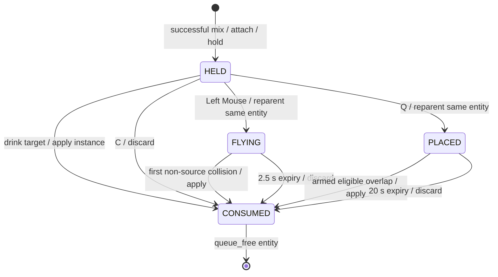

# Project Architecture

> Asset standard update (2026-11-17): [Production template](./ASSET_PRODUCTION_TEMPLATE.md). New character cells are 64 x 80 (384 x 320 sheet). Vessel 1 is delivered at 8 x 20 world / 16 x 32 UI; its PNG glass and masked contents replace the geometric bottle and mixer shell. Historical samples retain their original dimensions. Gameplay composition and camera conversion remain pending.

> Status: Technical source of truth
> Documentation update: 2026-11-18; two-release small-flask brewing implemented
> Automated verification: historical results below do not verify this change; main integration verification and manual tests are pending
> Current brewing plan: [Two-Release Brewing](./superpowers/plans/2026-11-17-two-release-brewing.md)
> Creative companion: [Style and Vision](./STYLE_AND_VISION.md)
> Player model guide: [PlayerModel](../characters/player/README.md)
> Visual reference pack: [Art Reference Index](./ART_REFERENCE_INDEX.md)
> Approved presentation plan: [Pixel-Art Conversion](./plannings/plans/2026-09-12-pixel-art-conversion.md)
> Approved gameplay direction: [Brewing, Vessels, and Strategic Placement](./plannings/specs/2026-09-15-potion-brewing-vision-design.md)

## Project Scope

CombatAlchemy is a Godot 4.x GDScript prototype. The active game is a
real-time potion combat sandbox reached from the main menu. The current slice
has player movement and collision, actors with reusable health components,
capability-based potion effects, one held physical potion, immediate drinking,
throwing and proximity placement,
two-release heat-controlled small-flask brewing, mixer UI, scene transitions, music,
settings, pause navigation, two disposable enemy archetypes for combat testing,
reusable timed status effects with an RGB slow potion, persistent RGB reagent
quantities, three refill-on-load reagent sources, and persistence for the one
currently held prepared potion.

There is no exploration layer, victory state, defeat state, or automatic
combat-completion return flow. Persistence is intentionally narrow:
`user://player_profile.cfg` stores reagent totals and an optional held bottle.
Health, position, enemies, unfinished brewing, source depletion, and flying or
placed bottles reset with the scene. The next technical goals, in order, are:

1. Manually verify and tune collection, inventory feedback, held-bottle restore,
   and the small-flask two-release interaction together.
2. Decide gameplay composition before converting remaining gameplay presentation; use the approved native asset sizes.
3. Tune the Pursuer and Skirmisher behaviours, then add obstacle-aware
   navigation only when arena geometry makes it useful.
4. Design one worthwhile harvesting interaction beyond the current instant
   five-dose prototype sources.
5. Add selected world objects with focused capabilities that existing potion
   effects can query.
6. Add victory, defeat, and encounter reset around the proven combat loop.

Exploration, refuge, discovery records, world-state persistence, richer enemy
perception, group behavior, and full expedition routing remain future vision
rather than current runtime architecture. See
[Project Goals and Scope](./STYLE_AND_VISION.md#project-goals-and-scope) for the
layered product direction.

Larger vessels, staged recipes, transformation, dormant placement with deliberate
activation, and prepared-potion storage are approved future direction, not new
runtime features. See [Brewing Evolution](#implemented-small-flask-and-future-brewing-evolution)
for the boundaries that a later implementation must preserve.

The code favors scene-local components. The only autoloads are application shell
services: settings, music, transitions, and scene routing. `GameManager` also
owns the lazily loaded `PlayerProfile`; profile, inventory, and file-store classes
remain focused non-autoload objects. Potion data, health, input translation, UI
rendering, player presentation, and potion entity motion remain independent of
the other autoloads.

## Presentation Migration Status

The [saved conversion plan](./plannings/plans/2026-09-12-pixel-art-conversion.md)
changes presentation, not the real-time alchemy concept. Its main-menu stage is
now implemented through the separate
[animated menu plan](./plannings/plans/2026-09-12-animated-main-menu-rebuild.md).
The `640 x 360` approval sample remains a composition reference only. The active
menu uses a native `1920 x 1080` redraw and scene-authored controls and layers.
Gameplay composition remains open; native dimensions follow the asset standard.
Tube 01 is implemented in PotionEntity and FlaskView. Researcher 01 is now the
active sprite model in combat and workshop; retired files are under `deprecated/`.

| Boundary | Current implementation | Approved replacement |
| --- | --- | --- |
| Display | Native `1920 x 1080` project canvas with nearest texture filtering | Keep `1920 x 1080` as the permanent project canvas; validate responsive layout at other 16:9 and wider windows |
| Camera and art scale | Player camera at default zoom `(1, 1)` with smoothing; existing world units | Undecided until gameplay composition is approved; do not infer world scale from the menu |
| Player visual | Researcher 01 AnimatedSprite2D, 64 x 80 cells at 2x; 384 x 320 sheet | Full character conversion implemented; preserve the established API |
| Animation | Four independently authored directions; two idle and four walk frames, 1.6/0.72-second loops | Discrete playback with phase-preserving turns |
| Direction | Positive-scale front/back/side-left/side-right, phase-aware turns and 0.10 hysteresis | Preserve facing rules, gait phase, idle retention, and anatomical hands; no mirroring or image crossfades |
| Sockets | Stable sibling markers updated from per-frame resource data; held entity follows `hand_right` | Stable `hand_left`/`hand_right` lookup with per-frame marker positions; the bottle remains separate from character art |
| Workshop | Same sprite model, movement room, readouts, frame/socket guides | Same model/workflow with frame bounds and socket guides; no separate production rig |
| Sandbox and UI | Passive Friend, H/J-spawned Pursuer/Skirmisher, plain arena, pixel-art tube-01 bottle/mixer, rebuilt animated main menu, existing pause/settings | Gameplay composition remains open; asset sizes follow the production template; retain flask-first interaction and hybrid detail |
| Transitions | Snapshot-based ink reveal | Pixel-grid reveal with unchanged duration/input-blocking/completion contract |

### Contracts to Preserve

- Keep `PlayerModel.set_motion()`, `set_facing_direction()`, `reset_to_idle()`,
  `set_playback_speed()`, `get_facing()`, `get_locomotion_state()`, `get_socket()`,
  and its facing/locomotion signals. Callers must not rely on bone paths.
- `set_debug_guides_visible()` is implemented; `set_debug_bones_visible()` remains
  a compatibility wrapper.
- Keep physics coordinates, collision shapes, movement speed, health, recipes,
  projectile trajectories, placement rules, and current immediate potion use.
  Render quantization must not quantize physics or continuous mouse aim.
- Preserve `PotionRecipeData` -> `PotionInstance` -> `PotionEntity` ownership,
  `HeldPotionSlot`, delivery-independent effects, and one-use consumption.
- Preserve autoload names, registered scene paths, music, audio buses,
  `user://settings.cfg`, pause, and scene routing. No new managers are required.
- Keep existing art/music as source material. Do not add AI, inventory, pickup,
  expeditions, or new diegetic menu interactions during this conversion.

The produced researcher and menu samples remain approved references. The menu
sample now guides composition only; it is not the runtime background. Gameplay
composition beyond the delivered hero and vessel remains open. Character and vessel dimensions are defined by the production template; terrain
scale remains open. Bone-specific tests have been replaced by frame/socket checks;
the existing gameplay suites retain their contracts.

## Current Runtime Flow

```text
project.godot
  -> mainmenu/StartMenu.tscn
	  -> MainMenu: Play
		  -> GameManager.start_new_game()
			  -> load/cache PlayerProfile
			  -> SceneTransition.transition_to_scene()
				  -> combat/CombatScene.tscn

CombatScene
  -> PlayerActor (world movement, camera, collision, health)
	  -> PlayerModel (15-bone visuals, four-facing idle/walk, sockets)
	  -> ReagentCollector: nearest source + E collection
  -> ReagentSources: red/green/blue, five doses each per scene load
  -> PotionCombatController
	  -> GameManager PlayerProfile + ReagentInventory
	  -> PotionInput: distinct Space presses, heat adjustment, focus intent
	  -> PotionMixer: layers + recipe match
		  -> reserve one owned dose for each unfinished layer
		  -> BrewingReaction: heat -> check/drop -> heat -> check/drop -> complete
		  -> preparation_requested(PotionInstance) with quality score and potency
		  -> one PotionEntity attaches to PlayerModel.hand_right
		  -> HeldPotionSlot retains the instance/entity pair
		  -> profile atomically spends reservations and stores held recipe/layers/quality
		  -> potion_prepared(PotionInstance)
			  -> drink(Player): direct PotionImpactContext
			  -> throw_into(Arena/PotionEntities, origin, direction): FLYING
			  -> place_into(Arena/PotionEntities, position): PLACED
				  -> eligible collision creates PotionImpactContext
			  -> PotionInstance.apply() -> PotionEffectResolver
				  -> recipe effects query subject components
	  -> scene load restores one saved held bottle by stable recipe ID
  -> EnemyTestSpawner: H/J spawn requests
	  -> Pursuer: notice -> chase -> melee windup -> recovery
	  -> Skirmisher: approach/retreat distance band -> ranged windup -> projectile

Play Current Scene
  -> characters/player/PlayerModelWorkshop.tscn
```

Escape opens `ui/PauseMenu.tscn`. Resume returns to the same scene; Main Menu
routes through `GameManager`; Quit calls `GameManager.quit_game()`.

## Directory Ownership

| Path | Ownership |
| --- | --- |
| `characters/player/` | Canonical compact player model, locomotion library, sockets, workshop, and model guide. |
| `combat/CombatScene.tscn` | Active potion sandbox composition and dependency wiring. |
| `combat/actors/` | Player movement, actor capabilities, neutral impact hitboxes, collision, cameras, world health bars, and status presentation. |
| `combat/enemies/` | Reusable enemy actors, profiles, local sensing/movement, separate tactical brains, attacks, projectiles, and sandbox spawning. |
| `combat/reagents/` | Refillable scene-local sources, nearest-source collection input, and cosmetic grain-stream feedback. |
| `combat/potions/` | Reagent constants, recipes, unfinished mixer layers, runtime potion instances, one held slot, delivery IDs, and physical potion entities. |
| `combat/potions/brewing/` | Deterministic two-release simulation, vessel tuning, visual/input presentation profile, and small-flask notes. |
| `combat/potions/effects/` | Stateless effect contracts, delivery context, resolver, and effect implementations. |
| `combat/potions/resources/` | Editable recipe book, recipes, and quality-to-potency profile. |
| `combat/ui/` | Flask rendering and bottom-center mixer controls. |
| `shared/alchemy/` | Project-wide semantic Charged Neon palette data shared by potion UI, recipes, menus, and VFX. |
| `vfx/reactive_crystal/` | Reusable crystal pile and shatter scenes plus an isolated five-color workshop. The shatter scene is not wired into active impacts yet. |
| `vfx/gold_sparks/` | Reusable continuous pixel-spark emitter plus separate burner and perfect-potion tuning resources. |
| `globals/` | Autoload services and scene-level music declarations. |
| `globals/profile/` | Persistent profile coordination, RGB quantity/reservation accounting, and versioned checked file storage. |
| `globals/resources/` | Scene registry and project information resources. |
| `mainmenu/` | Native 1920 x 1080 animated backdrop, reusable text commands, inline stepped settings, version metadata, and retained pause-settings scene. |
| `ui/` | Reusable pause menu. |
| `tests/` | Retained player/potion suites plus headless main-menu and reactive-crystal contracts. |
| `docs/` | Active architecture, visual direction, and local art references. |
| `docs/plannings/` | Historical designs/plans; the 2026-09-15 brewing design retains future vessel direction, but its small-flask mechanics are superseded by the 2026-11-17 plan under `docs/superpowers/plans/`. |
| `music/`, `sprites/`, `extra/` | Audio, remaining images, fonts, and shaders. |

## Scene Composition

### StartMenu And MainMenu

`mainmenu/StartMenu.tscn` remains the registered entry scene. It composes the
active `MainMenu.tscn` and the existing `LevelMusic` request for
`music/MainMenuNew.mp3`. Settings are now an inline view inside `MainMenu`; the
pause-specific `mainmenu/Settings.tscn` is no longer instanced by StartMenu and
remains owned by `ui/PauseMenu.tscn`.

`mainmenu/MainMenu.tscn` is authored on the permanent `1920 x 1080` project
canvas. It contains:

- `MainMenuBackdrop`: the approved grayscale laboratory base, two integer-wrapped
  cloud strips, two foliage loops, three pinned-note loops, three table crystal
  piles, three smaller shelf deposits, and editor-facing speed/glow tuning;
- a scene-authored two-line title and reusable text commands for Play,
  Settings, and Quit;
- `MainMenuSettingsView`, which replaces only the command list and maps Music
  and SFX between persisted decibels and ten visible steps;
- `VersionStone`, now an unframed version/build/current-focus text block.

Opening Settings does not reload or pause the backdrop. Back or Escape closes
the inline view and restores focus to Settings. Play loads the profile, forwards
the transition duration, and routes through `GameManager`; a load failure keeps
the menu interactive and opens its scene-authored error dialog.

### CombatScene

`combat/CombatScene.tscn` is the registered combat scene. Its root owns
`PotionCombatController` and composes:

- `Arena/Player`: `combat/actors/PlayerActor.tscn`, including
  `PlayerCombatController`, `characters/player/PlayerModel.tscn`, collision,
  following camera, `HealthComponent`, neutral `ImpactHitbox`,
  `ActorHealthBar`, and a 96-unit reagent collection area.
- `Arena/ReagentSources`: red, green, and blue `ReagentSource` instances at
  fixed sandbox positions. Each exposes five doses, depletes for the current
  scene visit, and refills when CombatScene is loaded again.
- `Arena/Friend`: passive `TargetActor.tscn` potion-testing target with starting health.
- `Arena/EnemyTestSpawner`: H/J developer spawner with authored Pursuer/Skirmisher
  markers, an `Enemies` runtime parent, and an `EnemyProjectiles` runtime parent.
  Combat deliberately begins without hostiles.
- `Arena/PotionEntities`: runtime parent for flying and placed potion entities.
  A newly mixed entity is added here before attachment; while held, its parent
  is the PlayerModel's `hand_right` socket. Release reparents the same node here.
- `Systems/PotionInput`: maps Input Map actions to potion intent signals,
  including distinct Space presses, heat adjustment, and focus changes.
- `Systems/PotionMixer`: owns unfinished reagent layers and recipe matching.
  Its authored `BrewingReaction` child owns height, power, two checks, drops,
  and blending. Each layer reserves one available inventory dose.
  The second reset requests a quality-bearing transactional preparation; only an attached,
  held, durably saved entity is acknowledged as prepared.
- `Systems/HeldPotionSlot`: holds references to exactly one instance/entity pair.
- `UI/PotionMixerUI`: displays layers, one height-mapped ideal bracket, gradual
  blending, two check scores, a short result, and stock-aware reagent controls.
  The `360 x 290` layout retains a `144 x 190` Tube 01 FlaskView and composes
  modular HeatControl/AlchemicalBurner scenes, with a `0..100` slider under the
  flame and a workshop for isolated presentation. Full recipe color appears
  only after the second reset.
- `UI/ProfileErrorDialog`: reports durable profile failures without consuming
  sources, ingredients, or the held bottle.
- `UI/PauseMenu`: reusable pause and settings overlay.
- `LevelMusic`: requests `music/CombatNew.mp3` from `MusicManager`.

Player and Friend remain present and targetable at zero health. Healing can
raise them above zero. Spawned enemies cancel their attack and remove
themselves at zero health. No component changes scenes or decides victory or
defeat.

### Enemy Actors

`Pursuer.tscn` and `Skirmisher.tscn` are independent `CharacterBody2D`
actors. Both own a body shape, `HealthComponent`, neutral `ImpactHitbox`,
world health bar, `EnemyMovement`, `EnemySenses`, an `EnemyAttack`, and
an archetype-specific brain. An actor receives its target explicitly from the
spawner; it does not scan the scene or rely on an autoload.

The Pursuer notices the Player within 900 pixels, chases until it is within
96 pixels, and commits one 10-damage sector strike after a 0.50-second windup.
The captured aim and 110-pixel / 120-degree hit sector make the strike
dodgeable. It has 90 HP and 0.85-second recovery.

The Skirmisher has 60 HP. It approaches beyond 480 pixels, retreats inside
280 pixels until 340 pixels, and holds/shoots at 420 pixels. After a
0.65-second windup it releases an 8-damage, fixed-direction dart; the dart
does not home, passes ignored actors, stops on a world body or Player, and
expires after 3.5 seconds. Recovery lasts 1.20 seconds.

### PlayerActor

`combat/actors/PlayerActor.tscn` owns active player world behavior. The root
`CharacterBody2D` runs `PlayerCombatController.gd`; it contains the canonical
`PlayerModel`, collision, camera, health, neutral impact hitbox, and health
bar. World velocity is passed directly to `PlayerModel.set_motion()`. Throw
origin is the model's `hand_right` socket, with the actor position as a
defensive fallback.

`get_potion_holder()` returns the `hand_right` `Marker2D`, or `null` if absent.
A missing holder rejects a new bottle; only throw-origin lookup falls back to
the actor position. `get_place_position()` is the player world position plus
`get_throw_direction() * place_distance` (default `64.0` pixels). The direction
is measured from the right hand toward the global mouse, with rightward fallback.

### PotionEntity

`combat/potions/PotionEntity.tscn` is one `Node2D` for the entire bottle lifetime.
It owns `BottleVisual` (masked-liquid `Sprite2D`), `Outline` (grayscale-glass `Sprite2D`),
`FlightArea/CollisionShape2D`, `SweepCast` (`ShapeCast2D`), and
`PlacementTrigger/CollisionShape2D`. The flight circle radius is `13` pixels;
the trigger radius is `42` pixels. Flight and sweep masks are `3` (world and
actor layers); placement mask is `2` (actor layer). Both areas have layer `0`.
Held and consumed states disable monitoring and the sweep; flying enables
flight monitoring and sweep; placed enables only placement monitoring.

These are runtime parenting and reference responsibilities, not persistent
inventory or changes to the Godot serialization `owner` property.

### PlayerModel

`characters/player/PlayerModel.tscn` owns presentation only. Its AnimatedSprite2D
uses Researcher01Frames and the exportable PlayerSpriteData resource. Eight named
idle/walk animations preserve four positive-scale facings and gait phase on turns.
64 x 80 cells display at 2x; FacingRoot y=38 retains the original ground alignment.
No runtime raw JSON loading, physics changes, action clips or animation delays.

Stable `hand_left` and `hand_right` markers are siblings of the sprite; metadata
updates position and draw order synchronously on frame/facing changes. Held potion
scale stays independent of the hero's display scale. Public motion, facing, reset,
speed and signal methods are unchanged; the new guide API retains the old bone
method as an alias. See the [PlayerModel guide](../characters/player/README.md).
Old rig resources, tests and unused hero art are in the ignored `deprecated/` folder.

### PlayerModelWorkshop

`characters/player/PlayerModelWorkshop.tscn` is the isolated Play Current
Scene workshop. `PlayerModelWorkshopActor.gd` owns movement and collision;
`PlayerModel.gd` remains presentation-only; `PlayerModelWorkshop.gd` keeps the
facing, locomotion, and frame/socket-guide controls synchronized. The workshop is not
registered in `project.godot` and is not a runtime dependency of combat.

## Retained Script Reference

Public methods below exclude Godot lifecycle callbacks and private methods
whose names begin with an underscore. `None` means the script intentionally
exposes no item in that category.
These are current script interfaces; future pixel rendering does not add or
remove methods from this reference until it is implemented.

### Player And Combat

| Script | Responsibility | Dependencies | Signals | Exports | Public methods |
| --- | --- | --- | --- | --- | --- |
| `characters/player/PlayerModel.gd` | Own sprite facing, discrete locomotion, frame-aligned sockets, and debug guides. | AnimatedSprite2D, Researcher01Frames and PlayerSpriteData. | `facing_changed`, `locomotion_changed` | `sprite_data` (`PlayerSpriteData`) | `set_motion()`, `set_facing_direction()`, `reset_to_idle()`, `set_playback_speed()`, `set_debug_guides_visible()`, `set_debug_bones_visible()`, `get_facing()`, `get_locomotion_state()`, `get_socket()` |
| `characters/player/PlayerModelWorkshop.gd` | Synchronize workshop status controls with the canonical model. | Workshop `PlayerModel`, labels, and bones toggle. | None | None | None |
| `characters/player/PlayerModelWorkshopActor.gd` | Move and collide the workshop actor while forwarding velocity to the model. | Input Map movement actions and a model exposing `set_motion()`. | None | `movement_speed`, `player_model_path` | None |
| `combat/PotionCombatController.gd` | Coordinate input, reserved mixing, durable held ownership, restoration, UI, and entity delivery. | `GameManager` profile, `PotionInput`, `PotionMixer`, `HeldPotionSlot`, `PotionMixerUI`, `PlayerCombatController`, optional collector, error dialog, entity parent and scene. | None | `potion_input_path`, `potion_mixer_path`, `held_potion_slot_path`, `potion_mixer_ui_path`, `player_combat_controller_path`, `potion_entities_parent_path`, `potion_entity_scene` | None |
| `combat/PotionInput.gd` | Translate distinct mix presses, heat adjustment, and focus changes; clear held controls on interruption. | Input Map, reagent/delivery IDs, presentation profile. | `mixer_toggle_requested`, `reagent_requested`, `mix_pressed`, `heat_adjust_requested(direction)`, `focus_changed(focused)`, `potion_use_requested`, `remove_reagent_requested`, `clear_mixture_requested` | `presentation_profile` | `clear_held_controls()` |
| `combat/actors/PlayerCombatController.gd` | Move the active player and provide holder and world-space delivery geometry. | Movement actions, `StatusEffectComponent`, and `PlayerModel.set_motion()`/`get_socket()`. | `movement_changed(current_velocity: Vector2)` | `speed`, `player_model_path`, `status_effects_path`, `place_distance` (`64.0`) | `set_movement_locked()`, `is_movement_locked()`, `get_potion_holder() -> Marker2D`, `get_throw_origin() -> Vector2`, `get_throw_direction() -> Vector2`, `get_place_position() -> Vector2` |
| `combat/actors/HealthComponent.gd` | Own bounded actor health. | None. | `health_changed`, `depleted`, `damaged` | `max_health`, `current_health` | `take_damage()`, `heal()`, `reset_health()`, `get_health_ratio()` |
| `combat/actors/ImpactHitbox.gd` | Map a collision-only area to the entity whose components effects may query. | Configured subject node. | Inherited `Area2D` signals | `effect_subject_path` | `get_effect_subject()` |
| `combat/actors/ActorHealthBar.gd` | Display an actor name, exact health values, and status row. | Configured `HealthComponent`, optional `StatusEffectComponent`, labels, bar, and `ActorStatusBar`. | None | `display_name`, `health_component_path`, `status_component_path` | None |
| `combat/actors/StatusEffectComponent.gd` | Own target-local timed status state. | None. | `statuses_changed(active_statuses)` | None | `apply_slow()`, `advance()`, `get_speed_multiplier()`, `get_active_statuses()` |
| `combat/actors/ActorStatusBar.gd` / `ActorStatusIcon.gd` | Present up to four scene-authored status slots above health. | Status snapshots from `StatusEffectComponent`. | None | None | `set_statuses()`, `set_status()`, `clear_status()` |
| `combat/enemies/EnemyProfileData.gd` | Store immutable Inspector tuning for one enemy archetype. | None. | None | Health, awareness, movement, attack, range, and projectile tuning. | `is_valid() -> bool` |
| `combat/enemies/EnemyActor.gd` | Wire local enemy capabilities, order sensing/decision/attack/movement, and remove depleted enemies. | Valid profile, health/status/hitbox, movement, senses, brain, attack, and body shape. | None | `profile` | `set_target(target: Node2D)` |
| `combat/enemies/EnemySenses.gd` | Track one assigned living target with notice/disengage hysteresis. | Explicit target and `EnemyProfileData`. | None | None | `set_target(target: Node2D)`, `refresh(origin, profile)`, `get_target() -> Node2D` |
| `combat/enemies/EnemyMovement.gd` | Convert a local movement request into `CharacterBody2D.move_and_slide()`. | Explicit body, profile speed, and optional target status capability. | None | None | `configure(body, speed, status_effects)`, `move_in_direction(direction)`, `stop()`, `advance()` |
| `combat/enemies/PursuerBrain.gd` | Choose idle, chase, or melee attack for the close-range archetype. | Configured senses, movement, attack, profile. | None | None | Inherited `configure()`, `tick()`, `get_state()` |
| `combat/enemies/SkirmisherBrain.gd` | Choose approach, retreat, hold, or ranged attack using stable distance bands. | Configured senses, movement, attack, profile. | None | None | Inherited `configure()`, `tick()`, `get_state()` |
| `combat/enemies/EnemyAttack.gd` | Own cancellable windup/recovery timing and authored telegraph feedback. | Actor, profile, authored `Telegraph` and `ImpactFlash`. | `executed` | None | `configure()`, `try_start(target) -> bool`, `advance(delta)`, `is_busy() -> bool`, `cancel()` |
| `combat/enemies/MeleeEnemyAttack.gd` | Resolve one captured-direction, range, and sector-checked strike. | Base attack and target `HealthComponent`. | Inherited `executed` | None | Inherited attack API. |
| `combat/enemies/RangedEnemyAttack.gd` | Release one fixed-direction projectile from a captured attack aim. | Base attack, configured `EnemyProjectile` scene, world projectile parent. | Inherited `executed` | `projectile_scene` | Inherited attack API. |
| `combat/enemies/EnemyProjectile.gd` | Sweep a fixed-direction enemy dart to Player/world collision or expiry. | Scene-authored `ShapeCast2D`, assigned target/source, target direct-child `HealthComponent`. | None | None | `launch(origin, direction, target, source, damage, speed, lifetime)` |
| `combat/enemies/EnemyTestSpawner.gd` | Handle H/J sandbox spawns and reject occupied markers. | Player, enemy/projectile parents, two markers, and two enemy scenes. | None | Paths, scenes, `spawn_clearance` | None |
| `shared/alchemy/AlchemyPaletteData.gd` | Provide the project-wide semantic Charged Neon reagent and prepared-potion colors. | None. | None | `red_color`, `green_color`, `blue_color`, `health_color`, `damage_color` | `get_color(color_id: StringName) -> Color` |
| `combat/potions/PotionReagent.gd` | Define supported reagent IDs and resolve their shared colors. | `ChargedNeonPalette.tres`. | None | None | Static `is_valid()`, `get_color()` |
| `combat/potions/PotionRecipeData.gd` | Describe one exact three-layer potion recipe and its composable effects. | `PotionReagent`, `PotionEffectData`. | None | ID, name, three counts, effects, mixed color | `is_valid()`, `matches_layers()` |
| `combat/potions/PotionRecipeBookData.gd` | Find order-independent layer matches or one unambiguous stable recipe ID. | `PotionRecipeData` resources. | None | `recipes` | `find_match()`, `find_by_id()` |
| `combat/potions/brewing/BrewingProfileData.gd` | Store two-release height/timing windows and provide the single scoring rule used by simulation and UI. | None. | None | `rise_rate`, `perfect_min`, `perfect_max`, `normal_min`, `normal_max`, `reset_duration` | `is_valid()`, `score_height()`, `is_perfect_height()` |
| `combat/potions/brewing/BrewingReaction.gd` | Simulate height, power, checks, drops, blending, suspension, and completion. | `BrewingProfileData`. | `state_changed(state)`, `reaction_changed(height, power, blend)`, `check_completed(index, score)`, `completed(score)` | `profile` | `start()`, `release_pressure()`, `set_heat_power()`, `set_suspended()`, `advance()`, `cancel()`, `get_state()`, `get_progress()` (height), `get_heat_power()`, `get_cycle_index()`, `get_quality_score()`, `get_blend_progress()`, `get_results()`, `is_editable()` |
| `combat/potions/PotionMixer.gd` | Own layers/reservations, recipe matching, quality lookup, and guarded pending preparation. | Inventory, recipe book, reaction, quality profile. | `layers_changed`, `preparation_requested`, `potion_prepared`, `mix_rejected`, `mixture_cleared`, `brewing_changed(state, height, power, blend)`, `check_completed(index, score)` | `max_layers`, `recipe_book`, `brewing_reaction_path`, `quality_profile` | `configure_inventory()`, `add_reagent()`, `remove_last()`, `clear()`, `start_brewing()`, `release_brewing()` (manual, not key-up), `set_heat_power()`, `set_suspended()`, brewing getters, `get_layers()`, `acknowledge_preparation()` |
| `combat/potions/PotionInstance.gd` | Own recipe, copied layers, quality score, potency multiplier, and once-only consumption. | Recipe, impact context, effect resolver. | None | None | `create()`, `get_recipe()`, `get_created_layers()`, `get_quality_score()`, `get_potency_multiplier()`, `get_color()`, `is_valid()`, `is_consumed()`, `apply()`, `discard()` |
| `combat/potions/HeldPotionSlot.gd` | Retain the one currently held instance/entity pair. | `PotionInstance`, `PotionEntity`. | `potion_changed(potion: PotionInstance)` (null on clear) | None | `hold(potion: PotionInstance, entity: PotionEntity) -> bool`, `clear() -> void`, `has_potion() -> bool`, `get_potion() -> PotionInstance`, `get_entity() -> PotionEntity` |
| `combat/potions/PotionEntity.gd` | Own one bottle through `HELD`, `FLYING`, `PLACED`, `CONSUMED` states. | `PotionInstance`, `PotionDelivery`, `PotionImpactContext`, scene visuals and collision nodes. | `state_changed(state: State)`, `resolved(context: PotionImpactContext, applied_effect_count: int)` | `flight_speed` (`650.0` px/s), `flight_lifetime` (`2.5` s), `arming_delay` (`0.35` s), `placed_lifetime` (`20.0` s) | `initialize(potion: PotionInstance, source: Node) -> bool`, `attach_to(holder: Node2D) -> bool`, `drink(target: Node) -> bool`, `throw_into(world_parent: Node2D, origin: Vector2, direction: Vector2) -> bool`, `place_into(world_parent: Node2D, world_position: Vector2) -> bool`, `discard() -> bool`, `get_state() -> State`, `get_potion() -> PotionInstance` |
| `combat/potions/PotionDelivery.gd` | Share `StringName` delivery constants `DRINK = &"drink"`, `THROW = &"throw"`, `PLACE = &"place"`. | None. | None | None | None |
| `combat/potions/effects/PotionEffectData.gd` | Define the stateless base contract and application result values for one effect. | `PotionImpactContext`. | None | None | `is_valid()`, `apply()` |
| `combat/potions/effects/HealthPotionEffectData.gd` | Heal or damage an impacted subject when it exposes `HealthComponent`. | `PotionEffectData`, `PotionImpactContext`, `HealthComponent`. | None | `operation`, `amount` | `is_valid()`, `apply()` |
| `combat/potions/effects/SlowPotionEffectData.gd` | Apply a timed movement reduction when an impacted subject exposes `StatusEffectComponent`. | `PotionEffectData`, `PotionImpactContext`, `StatusEffectComponent`. | None | `reduction` (`0.45`), `duration` (`5.0`) | `is_valid()`, `apply()` |
| `combat/potions/effects/PotionImpactContext.gd` | Carry delivery source, subject, collider, world geometry, and direct-child capability lookup. | Impacted scene nodes. | None | None | `configure()`, `is_valid()`, `find_component()` |
| `combat/potions/effects/PotionEffectResolver.gd` | Apply every valid recipe effect and count supported applications. | `PotionRecipeData`, `PotionEffectData`, `PotionImpactContext`. | None | None | `apply_recipe()` |
| `combat/ui/FlaskView.gd` | Render masked layers, liquid height, direct ideal marks, progressive blending, prepared color, gold perfect outline/sparks, and local release feedback. | Existing Tube 01 glass/mask, brewing/presentation profiles, reagent colors, GoldSparkEmitter. | None | Presentation tuning resource | `set_layers()`, `show_brewing()`, `is_ideal_cue_active()`, `show_check_feedback()`, `show_ready()`, `show_mixed()`, `show_failure()`, `reset_view()` |
| `combat/ui/PotionMixerUI.gd` | Present stock-aware controls, independent fire switch, heat adjustment, two scores, and short result. | FlaskView, inventory, HeatControl, AlchemicalBurner, BrewingAudioFeedback, presentation profile. | Reagent, heat, and fire-toggle intents | Presentation tuning resource | Inventory/open/state presentation methods; presentation never advances the simulation. |
| `combat/ui/BrewingAudioFeedback.gd` | Translate burner, heating, release score, and perfect completion state into replaceable sounds. | Scene-authored AudioStreamPlayers on the SFX bus. | None | None | `set_fire_state()`, `set_heating()`, `set_suspended()`, `play_release()`, `play_perfect_brew()` |
| `combat/reagents/ReagentSource.gd` | Persist one whole-source award before depleting its scene-local deposit and starting cosmetic feedback. | `PlayerProfile`, `PotionReagent`, authored prompt/deposit, collection-effect scene. | Inherited `Area2D` signals | `reagent`, `doses` (`5`) | `can_collect()`, `set_prompt_visible()`, `collect()` |
| `combat/reagents/PlayerReagentCollector.gd` | Select the nearest overlapping nonempty source deterministically and translate physical E into one collection attempt. | Injected `PlayerProfile`, player-centered `Area2D`, `ReagentSource`. | `collection_failed(message)` | `collection_area_path` | `configure()`, `select_nearest_source()` |
| `combat/reagents/ReagentCollectionEffect.gd` | Move authored grains from a depleted source toward the player after ownership is durable. | Scene-authored `Polygon2D` grains and tweens. | None | None | `play()` |
| `globals/profile/ReagentInventory.gd` | Own RGB totals and temporary reservations; derive availability and 999-unit logical stack counts. | `PotionReagent`. | `availability_changed(reagent, available)` | None | `set_totals()`, total/available/reserved/stack getters, `reserve()`, `release()`, `release_all()`, `apply_totals()`, `get_totals_copy()` |
| `globals/profile/PlayerProfile.gd` | Coordinate durable reagent collection, atomic preparation spending/held ownership, and checked held-record changes. | `ReagentInventory` and optional `PlayerProfileStore`. | None | None | Static `load()` and `create_in_memory()`; `collect_reagent()`, `commit_prepared_potion()`, `clear_held_potion()`, `restore_held_potion()`, `has_held_potion()`, `get_held_record()` |
| `globals/profile/PlayerProfileStore.gd` | Read and write versioned profile snapshots through verified temporary and last-good backup files. | `ConfigFile` and `FileAccess` at an injectable path. | None | None | `load_snapshot()`, `save_snapshot()`, static `delete_test_files()` |
| `vfx/reactive_crystal/ReactiveCrystalPile.gd` | Present one editable crystal deposit with settled geometry, localized glow, reflection, and low-simmer motes. | `AlchemyPaletteData`, authored polygons, `GPUParticles2D`. | None | `palette`, `color_id`, `crystal_color`, `glow_strength`, `motion_strength`, `mote_amount`, `random_seed` | `set_crystal_color()`, `set_glow_strength()`, `set_emitting()` |
| `vfx/reactive_crystal/PotionShatterParticles.gd` | Play and self-retire a color-configurable one-shot potion shatter visual. It does not resolve impacts or effects. | Two authored `GPUParticles2D` groups and cleanup timer. | None | `glow_strength`, `cleanup_delay` | `play_burst(world_position, color, incoming_direction)` |
| `vfx/reactive_crystal/ReactiveCrystalVFXWorkshop.gd` | Preview all five palette colors and manually trigger isolated shatter bursts. | Shared palette, pile scene, shatter scene, five authored controls. | None | None | None |
| `vfx/gold_sparks/GoldSparkProfileData.gd` | Store continuous spark frequency, visible-particle cap, velocity, gravity, and color. | None. | None | `emission_rate`, `max_visible_particles`, `speed_min`, `speed_max`, `gravity_y`, `spark_color` | `is_valid()` |
| `vfx/gold_sparks/GoldSparkEmitter.gd` | Apply one spark profile to scene-authored particles and gate emission by visibility/suspension. | GoldSparkProfileData, GPUParticles2D, shared particle shader/texture. | None | `profile`, `emitting` | `set_emitting()`, `is_emitting()`, `set_suspended()` |

### Application Shell

| Script | Responsibility | Dependencies | Signals | Exports | Public methods |
| --- | --- | --- | --- | --- | --- |
| `globals/GameManager.gd` | Lazily load/cache the one player profile and route high-level actions to registered scenes. | `PlayerProfileStore`, `SceneRegistryData`, `SceneTree`, optional `SceneTransition`. | `player_profile_error(message)` | `use_ink_transition`, `scene_registry` | `start_new_game()`, `get_player_profile()`, `go_to_main_menu()`, `quit_game()`; profile/path injection helpers for tests |
| `globals/Settings.gd` | Persist and apply Music/SFX bus levels. | `AudioServer`, `user://settings.cfg`. | None | None | `set_music_db()`, `set_sfx_db()`, `apply_audio()`, `save_settings()`, `load_settings()` |
| `globals/MusicManager.gd` | Own persistent scene music and crossfades. | `LevelMusic` nodes and requested audio bus. | Inherited `AudioStreamPlayer.finished` | `default_volume_db` | `crossfade_to()` |
| `globals/InkwashTransition.gd` | Change scenes behind a captured ink-wash snapshot. | Snapshot `TextureRect`, `ShaderMaterial`, and `SceneTree`. | `transition_finished` | `ink_reveal_time`, `transition_snapshot_path` | `is_busy()`, `set_transition_duration()`, `transition_to_scene()` |
| `globals/LevelMusic.gd` | Describe a scene's music request. | `AudioStream` and named audio bus. | None | `music`, `volume_db`, `crossfade`, `loop`, `bus` | `get_music()`, `get_crossfade()`, `get_loop()`, `get_volume_db()`, `get_bus()` |
| `globals/resources/SceneRegistryData.gd` | Register main-menu and combat scenes. | `PackedScene`. | None | `main_menu_scene`, `combat_scene` | None |
| `globals/resources/ProjectInfoData.gd` | Supply main-menu project metadata. | None. | None | `project_version`, `current_focus`, `build_label`, `show_focus`, `show_build_label` | None |
| `mainmenu/MainMenu.gd` | Switch the main command list and inline settings, preserve focus, lock transition input, show profile failures, and forward Play/quit. | `GameManager`, `SceneTransition`, `MainMenuSettingsView`, command components, error dialog. | None | `transition_duration` | `set_interaction_enabled()` |
| `mainmenu/MainMenuBackdrop.gd` | Apply authored cloud, wind, and reagent-light tuning without knowing menu navigation. | `LoopingPixelLayer`, ambient scene nodes, `AnimationPlayer`. | None | `far_cloud_speed`, `near_cloud_speed`, `wind_speed_multiplier`, `reagent_glow_strength` | `apply_tuning()` |
| `mainmenu/LoopingPixelLayer.gd` | Move two identical strips at integer positions and wrap them seamlessly. | `TileA` and `TileB` `TextureRect` nodes. | None | `speed_pixels_per_second`, `loop_width` | None |
| `mainmenu/MainMenuCommandButton.gd` | Present one reusable text command with focus rule and pressed displacement. | Authored Button and focus-rule nodes. | `activated` | `command_text` | `set_interaction_enabled()`, `grab_button_focus()`, `get_button()` |
| `mainmenu/AudioStepControl.gd` | Own a clamped 0-10 value and ten authored visual segments. | Minus/Plus buttons and segment nodes. | `step_changed(step: int)` | `label_text`, `initial_step` | `set_step()`, `get_step()`, `set_interaction_enabled()`, `focus_default()` |
| `mainmenu/MainMenuSettingsView.gd` | Convert stepped values to persisted Music/SFX decibels and request inline closure. | `Settings` autoload and two `AudioStepControl` components. | `close_requested` | None | `open()`, `close()`, `focus_default()`, `set_interaction_enabled()`, static `step_to_db()`, static `db_to_step()` |
| `mainmenu/SettingsMenu.gd` | Synchronize audio sliders with persistent settings. | `Settings` autoload and menu controls. | `close_requested` | None | None |
| `mainmenu/VersionStone.gd` | Present project version and focus metadata. | Labels and optional `ProjectInfoData`. | None | `project_info` | None |
| `ui/PauseMenu.gd` | Own pause input, settings navigation, resume, menu routing, and quit. | `SettingsMenu`, `GameManager`, and `ui_cancel`. | None | None | None |

### Test Runners

| Script | Responsibility | Dependencies | Signals | Exports | Public methods |
| --- | --- | --- | --- | --- | --- |
| `tests/PlayerModelTests.gd` | Validate the 15-bone model, animations, facings, sockets, bounds, public behavior, and dependency failures. | `PlayerModel.tscn` and player model resources. | None | None | None |
| `tests/PlayerModelWorkshopTests.gd` | Validate workshop composition, controls, movement, collision, camera, and debug bones. | `PlayerModelWorkshop.tscn`. | None | None | None |
| `tests/PlayerActorTests.gd` | Validate active player composition, movement/model forwarding, and throw origin/fallback. | `PlayerActor.tscn` and `PlayerModel`. | None | None | None |
| `tests/PotionInstanceTests.gd` | Validate instance creation, defensive layer copies, one-shot application/discard, delivery IDs, and held-slot ownership. | Potion instance, slot, entity, and effect scripts. | None | None | None |
| `tests/PotionDomainTests.gd` | Validate reagents, recipes, mixer signals/state, health, and movement lock. | Potion-domain and actor scripts. | None | None | None |
| `tests/PotionEffectPipelineTests.gd` | Validate impact subjects, recipe effect validation, health capability application, unsupported objects, and independent mixed-effect ordering. | Effect scripts, `ImpactHitbox`, and `HealthComponent`. | None | None | None |
| `tests/PotionEntityTests.gd` | Validate held attachment, entity identity, state transitions, drink/discard, flight and placement expiry, and rejected transitions. | `PotionEntity.tscn` and potion instance/effect scripts. | None | None | None |
| `tests/PotionEntityCollisionTests.gd` | Validate swept flight, actor/wall impacts, source exclusion, placement arming, stationary overlap, source exit/re-entry and first entry from outside, unsupported subjects, and expiry. Includes idle placement with production physics enabled at normal and zero arming delay. | `PotionEntity`, `ImpactHitbox`, physics bodies, and health data. | None | None | None |
| `tests/PotionUseTests.gd` | Validate drink/throw/place input, same bottle identity, slot clearing, UI closure, held-potion Tab gating, discard, and input with an empty slot. | `CombatScene.tscn` and potion/player runtime components. | None | None | None |
| `tests/MainMenuTests.gd` | Validate menu parsing, text commands, focus, inline settings replacement, 0-10 audio conversion, transition locking, native art, transparency, and ambient loops. | Main-menu scenes, imported menu textures, and application autoloads. | None | None | None |
| `tests/ReactiveCrystalParticleTests.gd` | Validate the shared palette, pile/shatter scene contracts, particle counts, cleanup, and five-color workshop composition. | Charged Neon palette and reactive-crystal scenes. | None | None | None |
| `tests/BrewingReactionTests.gd` | Validate two pressure releases, scoring boundaries, overflow, reset, suspension, idempotence, and frame-step-independent simulation. | Brewing reaction and small-flask profile. | None | None | None |
| `tests/BrewingCombatTests.gd` | Validate press/release input, forced release, pause freezing/resume, authored flask feedback, hidden settling, button locks, and clearing active reactions. | `CombatScene.tscn`, mixer UI, input, reaction, and held slot. | None | None | None |
| `tests/EnemyBehaviourTests.gd` | Validate tactical states, range hysteresis, melee dodging, windup/recovery, target loss, pause, and enemy deletion. | Enemy scenes and local components. | None | None | None |
| `tests/EnemyProjectileTests.gd` | Validate dart sweeps, source/other-actor filtering, wall blocking, fixed aim, expiry, and pause. | `EnemyProjectile`, Player, actor hitboxes, and physics fixtures. | None | None | None |
| `tests/EnemyCombatTests.gd` | Validate active H/J spawns, visible marker locations, occupied-spawn rejection, potion effects, and Player recovery. | `CombatScene.tscn`, real potion entity flow, enemy scenes. | None | None | None |
| `tests/StatusEffectTests.gd` | Validate RGB recipe ownership, slow stacking/cap/decay, refresh behavior, and unsupported subjects. | Status and potion effect contracts. | None | None | None |
| `tests/StatusPresentationTests.gd` | Validate the four-slot status row and Player/Friend/enemy status wiring. | Actor scenes and status UI scenes. | None | None | None |
| `tests/PlayerProfileTests.gd` | Validate stack boundaries, reservations, durable save/reload, held records, backup recovery, and corrupt/missing-primary handling. | Profile, inventory, and isolated test save paths. | None | None | None |
| `tests/ReagentCollectionTests.gd` | Validate source awards, failure rollback, RGB scene wiring, deterministic selection, E input, and cosmetic collection feedback. | Combat source/collector scenes and in-memory profiles. | None | None | None |

## Potion Data Flow

### Recipe, Instance, And Entity

`PotionRecipeData` is shared immutable configuration: exact reagent counts,
mixed color, and stateless effect resources. `PotionInstance` is a unique
`RefCounted` runtime preparation referencing that recipe, preserving a defensive
copy of the ordered creation layers, and recording whether it was consumed.
`PotionEntity` is the physical scene node that carries that same instance.
Two bottles may share a recipe, but never share their consumption state.

`PotionInstance.apply(context)` validates the instance and context, then marks
the instance consumed before resolving effects. It returns the supported-effect
count; zero supported effects still consumes a valid application. Invalid or
repeated application returns zero without applying effects. `discard()` marks
it consumed without effects. `is_valid()` checks preparation validity separately
from `is_consumed()`.

### Mixing And One Held Slot

1. `PotionInput` emits `mix_pressed` on distinct Space presses, never key-up or
   repeat, plus heat-adjustment and focus intent. Drink, throw, and place retain
   `potion_use_requested(delivery_method)`. Old agitation APIs are removed.
2. `PotionCombatController` accepts edits/mixing only with an open mixer and
   empty held slot. Tab remains ignored while holding a prepared bottle.
3. `PotionMixer.start_brewing()` validates an order-independent exact three-layer
   recipe. Invalid/incomplete recipes leave ingredients unchanged.
4. The first press starts heating; the next two distinct presses call manual
   `release_brewing()` / `release_pressure()`, one during each heat. Height
   `0..1` rises at `0.75 * power` per second; power is `0..1`, initially
   `0.5`. Inclusive `0.65..0.75` scores `+1`; inclusive `0.50..0.90`
   outside ideal scores `0`; all other heights score `-1`. Overflow at
   `1.0` automatically scores `-1`.
5. Each check drops/resets for `0.22` seconds. The first reset automatically
   starts the second heat; the second reset finishes even at total score `-2`.
   Scores sum to `-2..2`, mapped to `0.6/0.8/1.0/1.2/1.4` potency.
6. The mixer creates a quality-bearing candidate and emits
   `preparation_requested`. A pending guard blocks duplicate creation/edits.
   The controller initializes and attaches its entity, fills the held slot,
   atomically saves ingredient spending and held ownership, then acknowledges.
   Only successful acknowledgement clears layers and emits `potion_prepared`.
7. Construction, attachment, holding, or save failure rejects and cleans up the
   candidate without spending ingredients or leaving an orphaned usable bottle.
   The reservation/save handshake remains intact.

Ingredients are locked during heating, resetting, and pending preparation.
C cancels, clears layers, releases reservations, and invalidates completion.
Tab hides and suspends; reopening resumes. Pause and focus loss suspend and
clear held controls, without synthesizing a release. Hidden reactions do not
complete in the background. Movement remains available during active brewing.

### Bottle Lifecycle



The PNG companion `PROJECT_ARCHITECTURE_DIAGRAM.png` was not updated or
visually verified on 2026-08-30: direct image inspection failed with the
Windows sandbox deny-read ACL error. The existing PNG and import metadata
remain untouched; this Markdown describes the verified runtime lifecycle.

### Drink, Flight, And Placement

- **Drink:** Right Mouse calls the held entity's `drink(Player)`. It creates a
  `PotionImpactContext` with Player as subject and collider, the original source,
  Player world position, upward direction, and `PotionDelivery.DRINK`.
  The entity applies its instance, becomes consumed, emits `resolved`, and
  queues itself for deletion.
- **Throw:** Left Mouse calls `throw_into(Arena/PotionEntities, origin, direction)`.
  It reparents the held node, preserving identity, to the world parent and
  starts flight at the right-hand origin. Flight moves at `650` px/s, sweeps
  the full frame travel before movement, and consumes on the nearest detected
  non-source body/area collision or after `2.5` seconds. The source and its
  descendant collision objects are excluded. Impact uses `PotionDelivery.THROW`.
- **Place:** Q calls `place_into(Arena/PotionEntities, get_place_position())`.
  It reparents the same node `64` pixels from Player position in the hand-to-cursor
  aim direction. It does not raycast or clamp placement to walls. The bottle
  arms after `0.35` seconds and expires `20` seconds after placement.
  At arming, it chooses the nearest eligible currently overlapping collider;
  later eligible entries trigger immediately. The trigger monitors the actor
  layer, not ordinary world walls.
- **Source overlap:** after deferred monitoring activation, placement waits for
  a completed physics step and its overlap-query flush before initializing the
  source gate. Monitoring alone does not mean the overlap list is current.
  Source bodies/areas initially inside the trigger remain ineligible until all
  source overlaps leave; re-entry can then trigger the bottle. If the source
  starts outside, its first later entry is eligible.
  Other actors may trigger after arming even while the source remains inside.
  Placement context uses `PotionDelivery.PLACE` and the subject world position.
- **Successful release/use:** the controller clears the held slot and closes
  the mixer only when the entity method succeeds. The slot's `clear()` releases
  references; it does not itself consume, free, or reparent an entity.
  A rejected delivery leaves the held potion available. C discards a held
  bottle, clears layers and slot, and keeps the empty mixer open.

`ImpactHitbox.get_effect_subject()` maps actor collision areas to their entity;
ordinary bodies are their own effect subject. `PotionImpactContext` carries
`subject`, `collider`, `source`, `world_position`, normalized `direction`, and
a `StringName delivery_method`. Its `configure(...)` returns the context,
`is_valid()` requires a live subject, and `find_component(script)` searches the
subject and its direct children.

`PotionEffectResolver` attempts every valid recipe effect independently.
An effect applies only when the subject exposes its required capability.
A wall without `HealthComponent` therefore consumes a thrown health potion
with zero health effects. `resolved(context, applied_effect_count)` is emitted
for a context-based resolution, including zero applications; discard/expiry
does not emit it. No animation event delays, owns, commits, or cancels use.

### Current Persistence And Future Storage Boundary

The current profile persists unlimited RGB totals and one held bottle record
across scene changes and application restarts. Unfinished mixer reservations are
temporary; successful preparation atomically spends their layers and records
the held recipe ID, original layers, quality score, and potency multiplier.
Profile store V2 writes both quality values; V1 loads as normal quality (`0`,
`1.0`). The runtime `PotionEntity` is rebuilt from that record when combat loads.
Health magnitude uses `roundi(base_amount * multiplier)`; slow magnitude scales
while duration and the existing cap remain unchanged. Shared effects are not
mutated.

There is no multi-potion inventory, empty-bottle category, quest-item category,
pickup/recovery for finished bottles, storage container, or inventory screen.
Flying and placed entities, unfinished reactions, source depletion, health,
position, and enemies are not serialized. Settings persistence remains a
separate file.

A future inventory should own and transfer unused `PotionInstance`-equivalent
records without moving consumption state into shared recipe resources. Physical
scene attachment belongs to `PotionEntity`; the mixer remains a creator of
instances, not a storage service. Broader save formats, inventory UI, and
transfer rules are not implemented by this slice.

## Implemented Small Flask And Future Brewing Evolution

The [approved design record](./plannings/specs/2026-09-15-potion-brewing-vision-design.md)
owns the broader vessel and laboratory direction. Its historical small-flask
mechanics are superseded by the [two-release plan](./superpowers/plans/2026-11-17-two-release-brewing.md).
The following contract is being integrated; larger apparatus, multiple recipe
stages, storage, and deliberate persistent placement remain future scope.

### Behavior and Ownership Boundaries

| Concern | Current small-flask behavior | Future boundary |
| --- | --- | --- |
| Reaction input | First Space press starts heat; next two distinct presses release pressure. Tab suspends/hides; pause and focus loss suspend and clear holds. | Keep stage rules outside UI/autoloads. |
| Reaction state | `IDLE`, `HEATING`, `RESETTING`, `COMPLETED`; suspension preserves state. Two checks with automatic overflow and no recovery retry. | Keep stage state separate from `PotionEntity.State`. |
| Recipe completion | After two drops, every score prepares one quality-bearing instance, including `-2`. | Future multi-stage recipes create no bottle before their final stage. |
| Vessels | The active small flask accepts exactly three ingredient units and uses one shared profile resource. | Larger apparatus needs explicit capacity and stage data; changing `max_layers` alone is insufficient. |
| Flask feedback | Tube 01 glass/mask, one ideal bracket using liquid-height mapping, progressive blending, two scores, short result, and burner/slider. | Preserve mask clipping and grayscale glass; simulation stays outside presentation. |
| Finished effects | Drink, throw, and later activation deliver the same formula to compatible subjects. | Preserve immutable recipe/effect resources and target-owned capability state. Timing does not create delivery-specific health or transformation implementations. |
| Placement | A proximity bottle arms after 0.35 seconds and expires after 20 seconds; it is not persisted. | Add dormant bottles and deliberate activation separately; keep trigger policy and lifetime outside the effect resolver. |
| Storage and revisits | RGB totals and one held bottle survive scene/application reload; world bottles and source depletion do not. | Store domain identity and relevant placement records, not inactive scene nodes; retain one owner and once-only consumption. |

The initial field experiment uses one short reaction. A later laboratory recipe
adds meaningful stages rather than stretching the same hold. Capacities such as
3/5/8 units and a roughly 1-3 second field reaction are examples, not configured
values. Recipe knowledge may precede access to a suitable vessel. Portable bottle
size, batch yield, and storage are separate from brewing apparatus size.

The existing three recipes remain count-based and order-independent. Future stage
requirements must be explicit recipe data, not rules inferred from UI click
order. Larger recipes cannot work simply by changing an Inspector maximum:
`PotionMixer`, recipe validation/matching, instance validation, and flask layer
presentation all currently assume the three-unit model and need coordinated tests.

The intended final-stage handoff remains:

```text
ingredients + suitable vessel + brewing stage state
  -> successful final settle
  -> one PotionInstance
  -> one PotionEntity / HeldPotionSlot
  -> drink, throw, place, or later transfer to storage
  -> one activation resolves recipe effects against eligible capabilities
```

Quality is deterministic from the two checks, not a random potency roll.
There is no requirement for gel/solid forms, random potency rolls, permanent
brewing decay, or animation-delayed use. Unfinished brewing is distinct from a
finished potion waiting to be used.

### Transformation and Strategic Activation

A future transformation effect belongs in a `PotionEffectData` implementation
that asks a compatible subject component to own the transformation state.
Neither the receiving actor's Friend/Foe name nor the delivery method changes
the formula. Transformation duration, stats, visuals, and any area footprint are
not implemented or fixed by this vision.

The current resolver receives one subject per application. Any future area
activation needs explicit recipient collection and one consumption for the whole
activation; calling `PotionInstance.apply()` repeatedly for different subjects
would fail its once-only contract. Do not claim splash or area support exists.

The current placed bottle arms after `0.35` seconds, triggers eligible contact,
expires after `20` seconds, and is lost on scene unload. Return-and-activate play
therefore requires a separate change covering dormant state, intentional trigger,
safe placement, activation range, session identity, restoration, and consumption
across revisits. Raising `placed_lifetime` alone cannot implement that strategy.

Two-release verification is pending main integration. Required coverage includes
inclusive score boundaries, automatic overflow, two resets, one preparation,
power adjustment, suspension, cancellation, quality effects, V1/V2 persistence,
and reservation/save failure handling. Future vessel/storage work still needs
capacity/stage compatibility and no duplication or resurrection of preparations.

All new tuning stays in resources: `SmallFlaskBrewingProfile.tres` uses the new
`BrewingProfileData` semantics; `BrewingPresentationProfile_Default.tres` under
brewing owns visual/input tuning; `resources/PotionQualityProfile_Default.tres`
uses `PotionQualityProfileData`. The built-in generated and cleaned flame at
`sprites/vfx/alchemical_fire/alchemical_fire_v001.png` is four `16 x 16`
frames in a `64 x 16` sheet.

## Default Recipes

| Resource | Layers, any order | Effect |
| --- | --- | --- |
| `combat/potions/resources/HealthPotion.tres` | red, red, blue | `effects/Heal30.tres` |
| `combat/potions/resources/DamagePotion.tres` | green, green, blue | `effects/Damage30.tres` |
| `combat/potions/resources/SlowPotion.tres` | red, green, blue | `effects/Slow45_5s.tres`: 45% reduction, 80% cap, five-second shared linear decay |

`PotionRecipeBook_Default.tres` lists all three recipe resources. To add a recipe,
create a valid `PotionRecipeData` with exactly three total layers and at least
one valid `PotionEffectData`, then append it to that book.

To add a new effect family such as shape modification:

1. Add a focused component to subjects that support the behavior, for example
   `ShapeModifierComponent` with a small public API.
2. Add a stateless `PotionEffectData` subclass whose `apply()` asks the context
   for that component and returns `UNSUPPORTED` when absent.
3. Create an editable effect resource and add it to one or more recipe
   `effects` arrays. Do not modify `PotionEntity` or add an effect switch to
   `PotionCombatController`.

Shared effect resources must remain immutable at runtime. Timed or stateful
effects should ask a target component to create and own their runtime state.

## Input Actions

| Action | Default input | Owner |
| --- | --- | --- |
| `move_up`, `move_down`, `move_left`, `move_right` | W/S/A/D and arrows | `PlayerCombatController`, workshop actor |
| `toggle_mixer` | Tab | `PotionInput` |
| `add_red_reagent`, `add_green_reagent`, `add_blue_reagent` | 1/2/3 | `PotionInput` |
| `mix_potion` | Space: start heat, then two distinct pressure releases | `PotionInput` |
| Heat adjustment | Z/X: decrease/increase 5%; hold delay 0.3 s, repeat 0.1 s | `PotionInput`; slider 0..100 under flame |
| `drink_potion` | Right Mouse | `PotionInput` |
| `throw_potion` | Left Mouse | `PotionInput` |
| `place_potion` | Q | `PotionInput` |
| `remove_reagent` | Backspace | `PotionInput` |
| `clear_mixture` | C | `PotionInput` |
| `collect_reagent` | E | `PlayerReagentCollector` |
| `ui_cancel` | Escape | `PauseMenu` |

Space repeat and key-up do not release pressure. Tab hides and suspends an
unfinished reaction, reopening resumes it. Pause/focus loss suspend and clear
held controls; resumption must not retain a heat-adjustment hold.

## Recorded Runtime Verification

The detailed results below are historical (2026-09-23), not evidence for the
2026-11-17 two-release change. On 2026-11-18, all 22 current `tests/*Tests.tscn`
scenes passed headlessly with isolated `APPDATA`: `BrewingReactionTests` 334
checks, `BrewingCombatTests` 71, `PotionQualityTests` 359, and the retained
domain, entity, profile, menu, player, enemy, and status suites. Editor import
exited 0. OpenGL screenshots at 1920x1080 and 1280x720 confirmed visible
liquid, ideal-height bracket, and pixel flame. Godot emitted an environment-only
certificate-store warning; editor import also could not write its settings
inside the Steam engine directory. Neither reported a resource or script error.
Manual keyboard/mouse feel and audible music still require an interactive pass.

The import, scene smokes, active resource validation, and all twenty retained
test scenes were run on **2026-09-23** after repairing persistent inventory,
source collection, held-bottle restoration, and reservation ownership. The
checks cover simulation and contracts; the visual/manual checklist remains
separate below.

Godot `4.7.2.stable.steam.ed1daf0bf` was observed on 2026-09-23.
The GUI-subsystem executable is launched through `ProcessStartInfo` and
`WaitForExit` so exit codes and complete output are observable. Both the
positional CombatScene and test-scene paths are required; this Godot build accepts `--scene` without running a test scene.
Verbose smokes confirmed CombatScene and the project's StartMenu actually loaded.

### Import And Scene Smokes

```powershell
$godot = 'D:\SteamLibrary\steamapps\common\Godot Engine\godot.windows.opt.tools.64.exe'

function Invoke-GodotWait([string]$arguments) {
	$psi = [System.Diagnostics.ProcessStartInfo]::new()
	$psi.FileName = $godot
	$psi.Arguments = $arguments
	$psi.WorkingDirectory = (Get-Location).Path
	$psi.UseShellExecute = $false
	$psi.CreateNoWindow = $true
	$psi.RedirectStandardOutput = $true
	$psi.RedirectStandardError = $true
	$process = [System.Diagnostics.Process]::Start($psi)
	$stdoutTask = $process.StandardOutput.ReadToEndAsync()
	$stderrTask = $process.StandardError.ReadToEndAsync()
	if (-not $process.WaitForExit(60000)) {
		$process.Kill()
		$process.WaitForExit()
		throw "Godot timed out: $arguments"
	}
	Write-Output ($stdoutTask.Result.TrimEnd())
	Write-Output ($stderrTask.Result.TrimEnd())
	Write-Output "Exit code: $($process.ExitCode)"
	if ($process.ExitCode -ne 0) {
		throw "Godot exited $($process.ExitCode): $arguments"
	}
}

Invoke-GodotWait '--headless --editor --quit --path .'
Invoke-GodotWait '--headless --fixed-fps 60 --quit-after 120 --path . res://combat/CombatScene.tscn'
Invoke-GodotWait '--headless --fixed-fps 60 --quit-after 120 --path .'
```

Observed on 2026-09-23: editor import and the main project smoke exited `0` with
no parser, missing-resource, duplicate-UID, script, or failed-load diagnostics.
Combat composition is exercised by the retained combat suites with injected
in-memory profiles so verification never reads or writes the real player save.

### Retained Test Scenes

Run each suite through the same `Invoke-GodotWait` helper:

```powershell
Invoke-GodotWait '--headless --fixed-fps 60 --path . res://tests/PlayerModelTests.tscn'
Invoke-GodotWait '--headless --fixed-fps 60 --path . res://tests/PlayerModelWorkshopTests.tscn'
Invoke-GodotWait '--headless --fixed-fps 60 --path . res://tests/PlayerActorTests.tscn'
Invoke-GodotWait '--headless --fixed-fps 60 --path . res://tests/PotionInstanceTests.tscn'
Invoke-GodotWait '--headless --fixed-fps 60 --path . res://tests/PotionDomainTests.tscn'
Invoke-GodotWait '--headless --fixed-fps 60 --path . res://tests/PotionEffectPipelineTests.tscn'
Invoke-GodotWait '--headless --fixed-fps 60 --path . res://tests/PotionEntityTests.tscn'
Invoke-GodotWait '--headless --fixed-fps 60 --path . res://tests/PotionEntityCollisionTests.tscn'
Invoke-GodotWait '--headless --fixed-fps 60 --path . res://tests/PotionUseTests.tscn'
Invoke-GodotWait '--headless --fixed-fps 60 --path . res://tests/MainMenuTests.tscn'
Invoke-GodotWait '--headless --fixed-fps 60 --path . res://tests/ReactiveCrystalParticleTests.tscn'
Invoke-GodotWait '--headless --fixed-fps 60 --path . res://tests/BrewingReactionTests.tscn'
Invoke-GodotWait '--headless --fixed-fps 60 --path . res://tests/BrewingCombatTests.tscn'
Invoke-GodotWait '--headless --fixed-fps 60 --path . res://tests/EnemyBehaviourTests.tscn'
Invoke-GodotWait '--headless --fixed-fps 60 --path . res://tests/EnemyProjectileTests.tscn'
Invoke-GodotWait '--headless --fixed-fps 60 --path . res://tests/EnemyCombatTests.tscn'
Invoke-GodotWait '--headless --fixed-fps 60 --path . res://tests/StatusEffectTests.tscn'
Invoke-GodotWait '--headless --fixed-fps 60 --path . res://tests/StatusPresentationTests.tscn'
Invoke-GodotWait '--headless --fixed-fps 60 --path . res://tests/PlayerProfileTests.tscn'
Invoke-GodotWait '--headless --fixed-fps 60 --path . res://tests/ReagentCollectionTests.tscn'
```

Observed output on 2026-09-23 (all twenty exited `0`):

- `PlayerModelTests: PASS (469 checks)`
- `PlayerModelWorkshopTests: PASS (41 checks)`
- `PlayerActorTests: PASS (31 checks)`
- `PotionInstanceTests: PASS (37 checks)`
- `PotionDomainTests: PASS (19 tests)`
- `PotionEffectPipelineTests: PASS (20 checks)`
- `PotionEntityTests: PASS (54 checks)`
- `PotionEntityCollisionTests: PASS (119 checks)`
- `PotionUseTests: PASS (107 checks)`
- `MainMenuTests: PASS (menu contracts)`
- `ReactiveCrystalParticleTests: PASS`
- `BrewingReactionTests: PASS (30 checks)`
- `BrewingCombatTests: PASS (41 checks)`
- `EnemyBehaviourTests: PASS (45 checks)`
- `EnemyProjectileTests: PASS (103 checks)`
- `EnemyCombatTests: PASS (29 checks)`
- `StatusEffectTests: PASS (24 checks)`
- `StatusPresentationTests: PASS (24 checks)`
- `PlayerProfileTests: PASS`
- `ReagentCollectionTests: PASS`

The fifteen counted player/potion/brewing/enemy/status suites report `1,174 checks`
plus `19` domain tests; the four uncounted profile/collection/presentation suites
report contract-level pass/fail.
`PlayerModelTests` deliberately
reports missing `HandSocket_L` and `HandSocket_R` from its dependency-failure
fixtures. The other nineteen suites exited successfully. These runs include
automated input and physics coverage but do not establish GUI appearance,
audible music, or manual interaction quality.

The collision regression includes idle placement without prewarming or disabling
production physics, at both `0.35` and `0.0` seconds arming delay. It checks
initial source immunity, source exit/re-entry, first entry from outside, and an
already-overlapping non-source while the source stays inside. Competing eligible
overlap selection, held-reagent rejection, and entity construction/attachment
failure cleanup are not covered by these retained suites.

### Static Validation

The stale-interface scan found no active `mix_requested`, `PotionMixer.mix()`,
or instant-mixing references. Validation of quoted `res://` paths in active
`.gd`, `.tscn`, `.tres`, `.godot`, and `.gdshader` files inspected `139` unique
references: zero missing literal paths. The intentional dynamic `%s.tscn`
format string used by the enemy test was excluded.
Archived `.superpowers` clean-head snapshots were excluded because they retain
historical paths intentionally and are not loaded by Godot. Dynamic paths and
serialized `uid://` identifiers remain outside the literal-path scan; editor
import separately checked resource loading.

`git diff --check` exited `0`. The working tree also contains unrelated and
pre-existing main-menu, palette, VFX, player-art, and documentation changes;
verification describes the combined working tree and does not imply those
changes were created by the brewing implementation.

### Manual Godot Checklist

Status on 2026-11-18: every item below is **pending**, not manually verified.
The brewing checks reflect the approved two-release contract.

1. Open `characters/player/PlayerModel.tscn`. Verify the 15 bones, geometric
   parts, both hand sockets, `AnimationPlayer`, and `AnimationTree` are
   directly editable.
2. Play `PlayerModelWorkshop.tscn` as the current scene. Exercise all eight
   movement directions, stop in every facing, collide with all four walls,
   and toggle debug bones.
3. Choose Play. Verify combat displays the compact model, the camera follows
   it, actor collision remains intact, and the health bar follows. Use the
   workshop or collision-test fixtures for wall checks; the sandbox is not an
   authored bounded expedition room.
4. Open Tab, add red/red/blue, and press Space once. Confirm heating starts at
   50% power and key-up/repeat does not release. Press again in the ideal bracket
   for each heat; confirm two +1 checks, two 0.22-second drops, and one +2 bottle.
5. Check ideal boundaries 0.65/0.75, normal boundaries 0.50/0.90, and early/late
   releases. Confirm summed scores map to 0.6/0.8/1.0/1.2/1.4 potency.
6. Let both cycles overflow at 1.0. Confirm automatic -1 checks, automatic second
   heating, and a prepared -2 bottle after the second drop, without a retry.
7. Hide with Tab during heating and during reset; confirm height, drop time,
   and blend freeze, reopening resumes, and no hidden completion occurs.
8. Confirm reagent/Backspace edits are blocked during brewing and pending
   preparation. C cancels each unfinished phase, releases all reservations,
   and prevents any later preparation.
9. Check Z/X 5% steps, 0.3-second delay, 0.1-second repeat, slider parity, and
   zero-power height stability. Pause or switch focus while holding Z/X:
   progression suspends, holds clear, and resume causes no synthetic check.
   Movement remains available while brewing.

10. Use Right Mouse while Player is below maximum health. Confirm immediate
   healing, bottle removal, mixer closure, and no duplicate use on another press.
11. Brew green, green, blue; use Left Mouse. Confirm the same bottle leaves the
   hand, flies toward the cursor, and damages Friend or a spawned enemy.
12. Throw into empty space and confirm expiry after `2.5` seconds. In a wall
   collision fixture, confirm consumption with no health reaction.
13. Brew another potion; press Q. Confirm the same bottle is placed `64` pixels
   from Player in the aim direction, clears the held slot, and closes the mixer.
14. Confirm it waits `0.35` seconds before triggering another actor, ignores
   Player's initial overlap, and expires after `20` seconds if unused.
15. With a surviving placed healing potion fixture initially overlapping Player,
	step fully away and back after arming; confirm source re-entry is eligible.
	Ensure Player has missing health so the reaction is visible.
16. Press C while holding. Confirm the bottle is discarded, the held slot and
	unfinished layers clear, and the empty mixer stays open.
17. Verify Tab and reagent/mix edits are blocked while holding; Tab toggles the
	empty mixer normally. Confirm mixing and use do not lock movement.
18. Verify movement, camera following, actor collision, pause, settings, resume,
	music playback, and Main Menu/Play routing.
19. Inspect at `1920 x 1080` and `1280 x 720`; verify all reaction geometry is
   clipped to the flask; the single ideal bracket matches liquid height, the
   360 x 290 layout fits, both scores/result are readable, and the four flame
   frames animate. Layers blend gradually and reach full color only after the
   second reset. Preview HeatControl and AlchemicalBurner in their workshop.
20. Start combat. Confirm it contains Friend, no hostile enemies, and two visible
	spawn rings: `H · Skirmisher` on the right and `J · Pursuer` on the left.
21. Press H. Confirm the Skirmisher approaches from far away, retreats if approached,
	then stops to show its telegraph and fire a dodgeable straight dart. Press H
	again while its marker is occupied and confirm a short red marker flash.
22. Press J. Confirm the Pursuer chases, stops, displays a sector telegraph, and
	only damages the Player at the end of its windup when the Player remains in
	front of it. Step aside during the windup to dodge.
23. Damage each spawned enemy to zero with green-green-blue potions. Confirm it
	cancels its action and disappears. Use red-red-blue on a damaged enemy before
	it reaches zero and confirm it heals. Pause during either windup or dart flight
	and confirm its timing freezes.
24. With an empty profile, confirm all three mixer counts begin at zero. Approach
	the red, green, and blue sandbox deposits; only the nearest nonempty source
	shows E. Collect each source once and confirm it grants five doses, loses its
	neon deposit for that visit, and cannot be collected twice.
25. Return to the menu or restart the application, choose Play, and confirm the
	collected RGB totals persist while all three world sources have refilled.
26. Collect at least five red and five blue, brew red-red-blue, and confirm the
	counts become three red and four blue only after the bottle is attached and
	saved. Restart and confirm the held health bottle is restored at the hand.
27. Drink, throw, place, or discard that restored bottle, restart, and confirm it
	does not return. Confirm thrown/placed bottles and unfinished mixtures are not
	restored.

## Change Guidelines

- Keep `PlayerModel` presentation-only; world movement, collision, camera, and
  health belong to `PlayerActor` and its actor components.
- During current-rig maintenance, preserve its bone/rest contracts. The approved
  pixel conversion may replace those internals, but must preserve four authored
  facings, positive scale, gait phase, public motion API, and stable socket IDs.
- Keep delivery coordination in `PotionCombatController`, physical lifecycle
  in `PotionEntity`, and one-shot application in `PotionInstance`; animation is
  visual feedback and must not own gameplay outcomes.
- Keep recipe matching in resource data and mixer code, not scene controllers
  or UI scripts.
- Keep brewing-stage state separate from finished bottle lifecycle;
  create an instance only after the final successful stage. Do not expand
  recipe capacity, trigger behavior, or persistence as part of an art-only change.
- Keep health reusable and free of scene routing or victory decisions.
- Keep collision consumption separate from effect support. A bottle impact
  must not require a health component or a universal potion receiver.
- Add new potion behavior through effect resources and focused capability
  components, not central effect-type switches.
- Add new routed scenes through `SceneRegistryData` and `GameManager`.
- Keep developer workshops out of `project.godot` runtime routing.
- Add or update focused headless scene coverage when a public contract changes.
- Route durable reagent and held-bottle mutations through `PlayerProfile`. Scene
  components may reserve or present quantities but must not write profile files.
- Keep current behavior, approved migration, and later goals separate in docs.
  Historical plans are not evidence that every described feature is implemented.
